# Safe Vulnerability Assessment of an Intentionally Vulnerable Web Application (OWASP Juice Shop)

> **Final Markdown version.** This is the source for the MS Word submission. The main body
> (sections 2–11) is the part counted against the 3,500-word limit. The Appendix has no limit.
> Items marked **[TEAM]** can only be supplied by the named member(s).

---

## 1. Cover page *(excluded from word count)*

- **Title:** Safe Vulnerability Assessment of an Intentionally Vulnerable Web Application (OWASP Juice Shop)
- **Course / semester:** CMPS 380 Cybersecurity Fundamentals — Fall 2026
- **Group ID:** G02

| Member | QUID | Contribution |
|---|---|---:|
| Najeeb Abdi | 202307172 | 25% |
| Mohanad Elhabash | 202314448 | 25% |
| Moaaz Mohamed | 202207862 | 25% |
| Ahmed Hari | 202203669 | 25% |
| **Total** | | **100%** |

- **Contribution agreement:** all four members agreed this distribution on 2026-10-30.
- **Main-report word count (sections 2–11, excluding the Appendix):** 2,581 (Microsoft Word count, 30 October 2026)
- **Submission date:** **[TEAM]** date of upload (deadline: 14 November 2026, midnight)

---

## 2. Introduction and motivation

Web applications are among the most exposed components of modern systems. They are reachable
over the network, they process untrusted input, and they control access to user data. The
OWASP Top 10:2025 ranks Broken Access Control (A01) and Security Misconfiguration (A02) as the
two most important web risk categories, with Security Misconfiguration rising to second place
in this edition [1]. One control failure can expose many users, so assessing web applications
before and during deployment is a core defensive practice.

No single technique finds every weakness. Automated scanners quickly surface broad classes of
issue, but they produce false positives and miss logic flaws. Manual testing confirms real
impact but is slower. A layered assessment (reconnaissance, automated scanning, and manual
verification) therefore gives more reliable results than any one method alone. It also lets a
team separate confirmed vulnerabilities from unverified scanner alerts.

The problem this project addresses is practical. Given a realistic vulnerable web application,
can a small team safely identify, verify, prioritise, and remediate real weaknesses using
industry methodology, while producing defensible evidence? To do this ethically we worked only
inside an isolated local lab against a deliberately vulnerable training target, OWASP Juice
Shop [2], using synthetic accounts and non-destructive techniques. No public, university, or
third-party system was touched. This controlled-lab context is what makes offensive techniques
appropriate here: the activity is authorised, contained, and reversible.

## 3. Objectives and research question

**Main objective:** perform a safe, methodical security assessment of OWASP Juice Shop in an
isolated lab, and demonstrate the full cycle from discovery to remediation and retest.

**Sub-objectives (measurable):**

1. Build and verify an isolated, reproducible lab bound to loopback only.
2. Use at least two assessment approaches (automated and manual).
3. Reproduce three to five findings manually, each with sanitized evidence.
4. Prioritise findings using CVSS-informed reasoning.
5. Remediate and retest at least one finding with before/after evidence.

**Research question:** *Can a layered, safe assessment of an intentionally vulnerable web
application reliably distinguish confirmed, reproducible vulnerabilities from automated-scanner
noise, and demonstrate an effective remediation?*

**Success criteria:**
- an isolated lab;
- at least two assessment approaches;
- at least three verified findings, each with evidence and a reviewer;
- at least one finding remediated and retested;
- an honest statement of limitations.

## 4. Application, use cases, and threat model

**Why Juice Shop.** OWASP Juice Shop is a widely used, deliberately insecure application built
for security training [2]. It contains realistic modern vulnerabilities, ships with synthetic
data, and can run fully offline in Docker. That makes it ideal for a safe, authorised
assessment. Technically, it is a single-page Angular front end backed by a Node.js REST API,
with JSON Web Token (JWT) authentication. This is the same architecture as many production
web applications.

**Synthetic roles and assets.** We modelled four actors:
- an unauthenticated visitor;
- a normal synthetic user;
- a privileged synthetic user;
- the authorised tester.

The assets these actors touch are synthetic accounts, session tokens (JWT), test order and
basket data, and the application's integrity and availability. We defined four trust
boundaries:
- browser → application;
- one user → another user's objects;
- normal user → privileged functions;
- application → local data store.

**Selected scenarios.** From the threat model we defined five scenarios, each mapped to a test
case and a finding record:
- S1: attack-surface discovery;
- S2: broken access control / IDOR;
- S3: cross-site scripting / input validation;
- S4: security misconfiguration / information disclosure;
- S5 (optional): authentication and session review.

The scenarios define what we looked for. Only reproduced results are reported as findings.

**Scope and authorization.** All activity was limited to `http://127.0.0.1:3000`, plus the
remediation proxy at `127.0.0.1:8080`. We used only synthetic accounts and non-destructive
proof-of-concept steps. Out of scope were:
- any public, university, or cloud system;
- real data;
- denial of service;
- credential theft;
- malware;
- container escape.

All four members approved the written scope and authorization statement on 2026-10-28
(Appendix C).

## 5. Methodology

We followed a layered process aligned with the OWASP Web Security Testing Guide (WSTG) [3] and
the phases of the Penetration Testing Execution Standard (PTES) [4]:

1. **Scope and authorization:** fix the target, boundaries, and safety rules before any test.
2. **Reconnaissance:** safe local service and version discovery to map the attack surface.
3. **Automated scanning:** a controlled OWASP ZAP quick scan (spider plus active scan) to
   surface candidate issues.
4. **Manual verification:** reproduce each candidate by hand with recorded request/response
   pairs, and discard anything that cannot be reproduced.
5. **Risk analysis:** score confirmed findings with CVSS v3.1 plus a qualitative risk rating.
6. **Remediation and retest:** apply a defensive fix and repeat the same test to get
   before/after evidence.

Two safety controls ran throughout:
- The target was bound to loopback only.
- Every captured artefact was sanitized: synthetic accounts, redacted tokens, and no sensitive
  file contents copied.

Scanner alerts were treated as leads, never as confirmed vulnerabilities, until they were
manually verified. That rule is the core of our automated-versus-manual comparison. A
team-written Python script (Appendix D) indexed the evidence and checked it for leftover
secrets before submission.

## 6. Lab environment and tools

The lab ran on Windows 11 Pro (build 10.0.26300) with Docker Engine 29.9.1 [11]. The target
was OWASP Juice Shop 20.3.0 (`bkimminich/juice-shop`, digest `sha256:4284…53f4`), published to
`127.0.0.1:3000` only (Figure 1). The tools were:
- Nmap 7.993 with Npcap 1.90 for discovery [9];
- OWASP ZAP 2.17.0 for automated scanning [10];
- Google Chrome 156 developer tools and `curl` for manual verification;
- an nginx 1.27 reverse proxy for remediation;
- a small custom Python script for evidence handling.

Burp Suite and Nikto were available but would have duplicated ZAP and `curl`, so they are
recorded as "not used" rather than claimed.

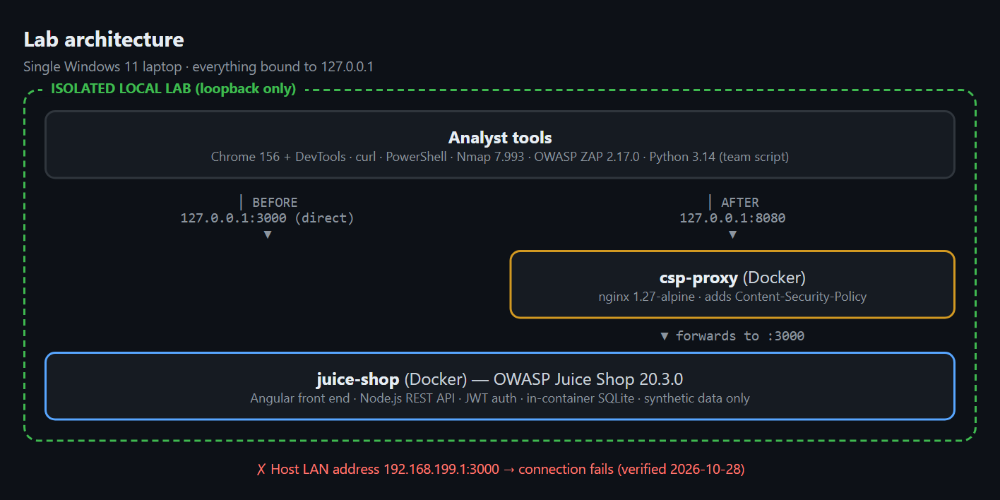

*Figure 1 – Lab architecture. All components are bound to 127.0.0.1. The direct port (:3000)
and the remediation proxy (:8080) allow a before/after comparison.*

**Why these tools.** Each tool did a different job:
- Nmap confirms which ports and services are exposed.
- ZAP gives broad automated coverage of common web issues.
- Browser dev tools and `curl` give precise, scriptable manual control for proofs of concept.

Each also has limits. Nmap may misfingerprint an app: it reported our HTTP service as `ppp?`.
ZAP produces false positives and misses logic flaws. Manual testing is narrow by design. Using
the tools together offsets these individual weaknesses.

**Isolation controls.** We verified three things on 2026-10-28:
1. The container publishes to `3000/tcp -> 127.0.0.1:3000` (loopback, not `0.0.0.0`).
2. The app answers `HTTP/1.1 200 OK` on loopback.
3. A request to the host's LAN IP (`192.168.199.1:3000`) failed with HTTP 000, showing the
   target was not reachable off-host.

The output is shown in Appendix E (Figure E2). A confirmatory check from a second physical
device is still recommended and is noted as a limitation.

## 7. Verified findings and proof of concepts

**Reconnaissance.** Nmap found a single open port, 3000/tcp (Figure 2). The service label
`ppp?` is a fingerprint miss: the raw response Nmap captured is an HTTP 200 page from Juice
Shop. The output already hinted at later findings, because it contained
`Access-Control-Allow-Origin: *`.

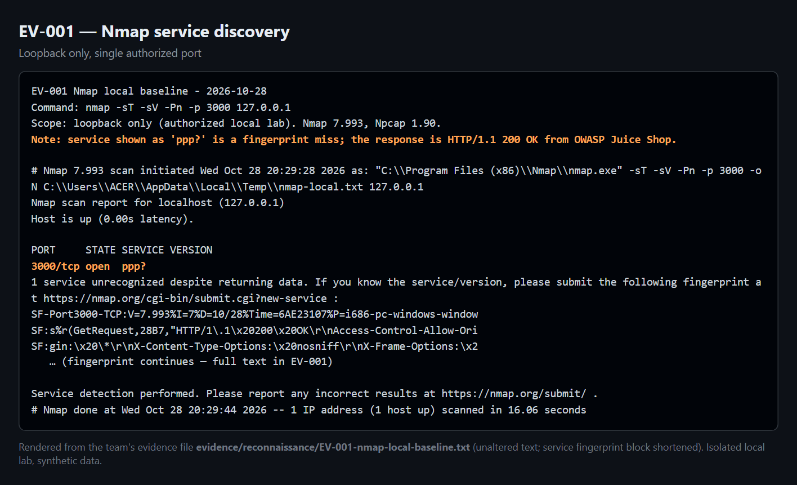

*Figure 2 – Nmap discovery against the single authorized port (EV-001).*

**Automated scan.** The ZAP quick scan reported 0 High, 2 Medium, 0 Low, and 3 Informational
alerts (Figure 3). We manually confirmed the two Medium alerts, which became WA-001 and WA-002.
We reviewed the Informational alerts and did not promote them. One of them ("Modern Web
Application") warns that the traditional spider may miss routes built by JavaScript.

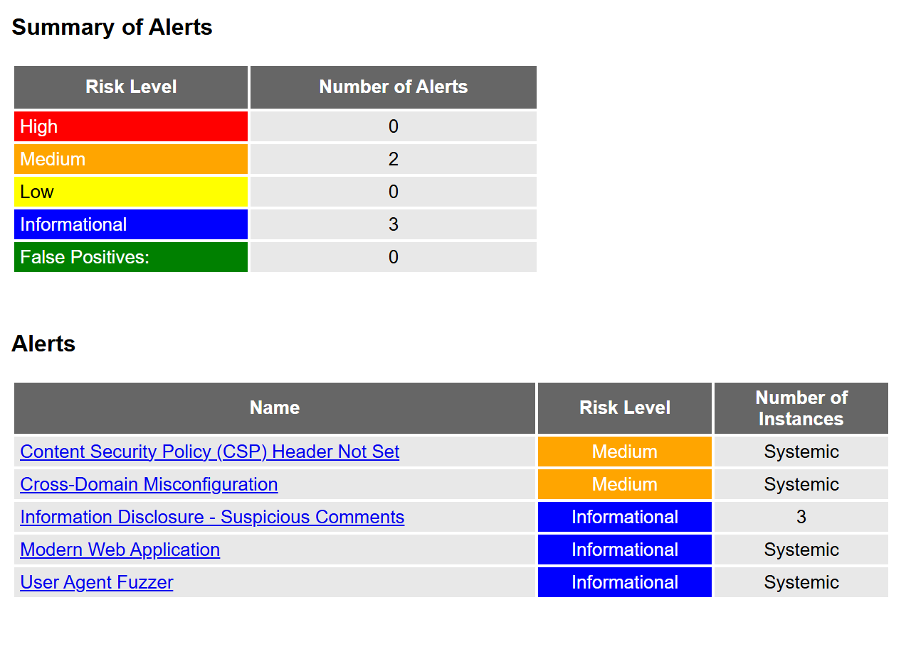

*Figure 3 – OWASP ZAP 2.17.0 alert summary (EV-002).*

Four findings were reproduced manually:

| ID | Finding | OWASP 2025 | CVSS v3.1 | Overall risk | Status |
|---|---|---|---|---|---|
| WA-003 | Unauthenticated `/ftp` directory listing exposes internal files | A02 (also A01) | 7.5 High | High | Open |
| WA-004 | IDOR on `/rest/basket/:id`: read another user's basket | A01 | 6.5 Medium | High | Open |
| WA-001 | Missing Content-Security-Policy header | A02 | 4.3 Medium | Low–Medium | **Remediated + retested** |
| WA-002 | Overly permissive CORS (`Access-Control-Allow-Origin: *`) | A02 | 5.3 Medium | Low | Open |

**WA-003: Unauthenticated `/ftp` directory listing.** An unauthenticated `GET /ftp` returns an
HTTP 200 directory listing of 11 internal entries (Figure 4). The listing includes backup files
and a KeePass credential store (`incident-support.kdbx`). The files download without any login
(HTTP 200 on `/ftp/acquisitions.md`). We deliberately did **not** open, copy, or crack any
file. The expected behaviour is that internal, backup, and credential files are never served
and directory listing is disabled. This is our highest-impact finding.

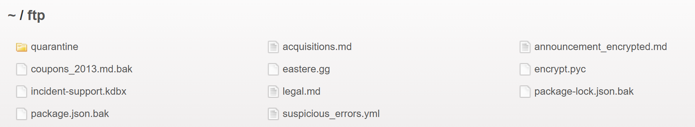

*Figure 4 – Live capture of `http://127.0.0.1:3000/ftp` with no session (WA-003).*

**WA-004: IDOR on `/rest/basket/:id`.** We created two independent synthetic accounts and
logged in as user B (basket 7). We then requested `GET /rest/basket/6`, user A's basket, by
substituting the id (Figure 5). The server returned HTTP 200 and A's basket object
(`"UserId":25`) to B (`"UserId":26`). A request with no token or an invalid token is correctly
rejected with 401. So the endpoint authenticates the caller, but does not check that the caller
owns the requested object. This is a textbook insecure direct object reference [5]. The ids
were low sequential integers, which makes enumeration trivial.

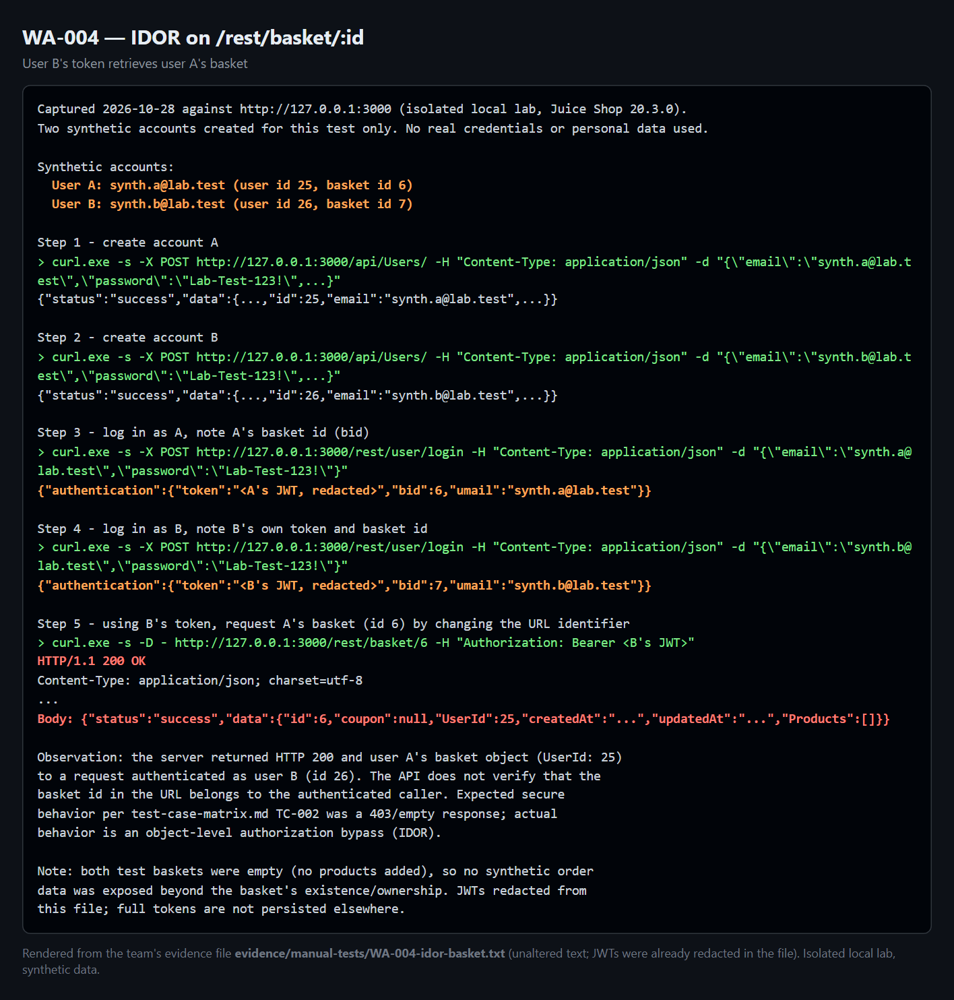

*Figure 5 – User B's token returns user A's basket. JWTs are redacted (WA-004).*

**WA-001: Missing Content-Security-Policy header.** HTTP responses omit a
`Content-Security-Policy` header, so the browser applies no policy restricting where scripts may
load from [6] (Figure E3). On its own this is a defence-in-depth gap rather than a direct
exploit. Its risk is that it would amplify any injection flaw. This is the finding we
remediated (§9).

**WA-002: Overly permissive CORS.** The server returns `Access-Control-Allow-Origin: *`,
including for a request that carries a foreign `Origin` header [7] (Figure E4). Browsers do not
send credentials with a wildcard origin, so only non-credentialed, non-sensitive data can be
read cross-origin. We therefore rated this Low and did not overclaim it.

**Automated vs manual.** ZAP flagged WA-001 and WA-002. WA-003 and WA-004 were found by manual
testing and were not reported by the ZAP quick scan. This is direct evidence that automated
tools alone would have missed our two highest-risk findings.

## 8. Risk analysis and CVSS reasoning

Each finding was scored in two ways [8]:
- a CVSS v3.1 base vector, which anyone can reproduce;
- a qualitative Likelihood × Impact rating for this training context.

Where the two differ, we show both rather than bending the vector to fit a label.

- **WA-003** `AV:N/AC:L/PR:N/UI:N/S:U/C:H/I:N/A:N` = **7.5 High.** Exploitation is trivial and
  needs no login, and it exposes sensitive internal files. Likelihood High × Impact High →
  High.
- **WA-004** `AV:N/AC:L/PR:L/UI:N/S:U/C:H/I:N/A:N` = **6.5 Medium.** Any authenticated user can
  read another user's object, and the ids are guessable. Integrity is scored None because the
  write/tamper paths were not tested. Likelihood High × Impact Medium–High → High overall.
- **WA-001** `AV:N/AC:L/PR:N/UI:R/S:U/C:L/I:N/A:N` = **4.3 Medium.** It has no direct impact on
  its own, and a purist scoring would call it Informational until an XSS is confirmed. Our
  qualitative rating is Low–Medium, because it amplifies other flaws.
- **WA-002** `AV:N/AC:L/PR:N/UI:N/S:U/C:L/I:N/A:N` = **5.3 Medium**, adjusted down to a
  qualitative **Low** because no credentialed cross-origin read was demonstrated.

Technical severity (CVSS) and business risk can diverge. WA-001 scores "Medium" mechanically
but carries little standalone business risk. WA-003's exposure of a credential store, by
contrast, is a real business concern consistent with its High score. The resulting fix order
is WA-003, then WA-004, then WA-002. WA-001 is already remediated.

## 9. Remediation and retesting

We remediated **WA-001**. Rather than modify the prebuilt image, we placed an nginx reverse
proxy in front of Juice Shop, on loopback, that injects a restrictive policy:
`default-src 'self'; script-src 'self'; style-src 'self' 'unsafe-inline'; img-src 'self' data:;
frame-ancestors 'self'; object-src 'none'`.

What the key directives do:
- `script-src 'self'` allows only scripts from the application's own origin, which blocks
  injected or third-party scripts.
- `frame-ancestors 'self'` prevents framing by other sites (clickjacking).
- `object-src 'none'` disables plugins.

This mirrors how security headers are added in production (at the web tier, a WAF, or
middleware), and it is fully reversible.

We chose WA-001 for the required fix-and-retest cycle because it could be fixed safely without
modifying the vulnerable application. WA-003 and WA-004 need changes to Juice Shop's own
routing and code. In a real engagement they would be fixed first.

**Before/after.** We repeated the same `curl` command against both ports:
- Direct access (`:3000`) returned no CSP header (Figure 6).
- Access through the proxy (`:8080`) returned the policy above (Figure 7).

`Server: nginx/1.27.5` confirms the traffic passed through the proxy. `Content-Length` was 9984
in both cases, which confirms the same page was served and the application still worked. The
retest is recorded in `evidence/05-remediation-retest/retest-record.md`.

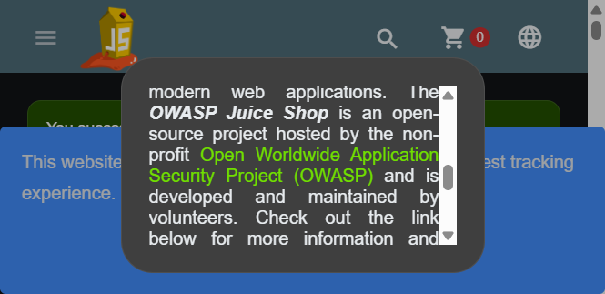

*Figure 6 – Before: response headers from port 3000. No Content-Security-Policy.*

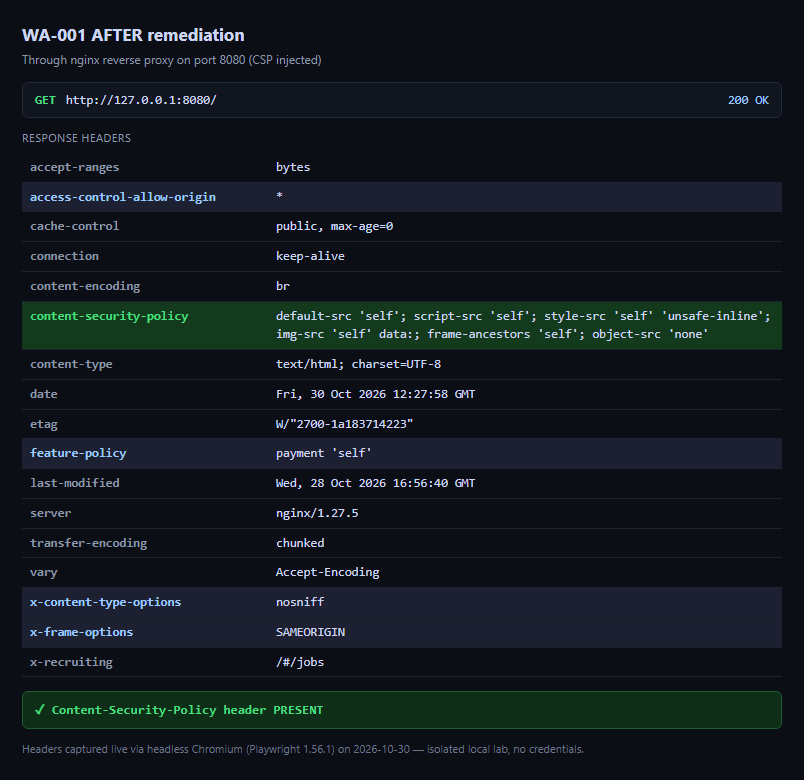

*Figure 7 – After: response headers through the proxy on port 8080. CSP present.*

**Residual risk.** Two limitations remain:
- The policy uses `style-src 'unsafe-inline'`, because Juice Shop's Angular front end relies on
  inline styles. A new application would use nonces or hashes instead.
- The fix enforces CSP only for traffic through the proxy. That is acceptable in the lab, where
  both ports stay open for comparison. In production, the app would be reachable only through
  the proxy.

The proxy does not change the CORS header, so WA-002 remains open.

## 10. Impact, learning outcomes, and limitations

**Impact on security practice.** The project shows, end to end, how a small team can safely
turn a vulnerable application into verified findings, prioritised risk, and a demonstrated fix.
The clearest lesson for developers is defence in depth. WA-001 (missing CSP) has no direct
impact, yet it would magnify any injection bug, so controls should be layered rather than
relied on singly.

**Benefit to stakeholders.**
- Developers learn to enforce server-side authorization on every object request (WA-004) and to
  keep backup and credential files out of any web-served path (WA-003).
- Testers gain a repeatable, evidence-first workflow.
- Users ultimately benefit from reduced exposure of their data.

**Possible misuse and safeguards.** The same techniques could be abused against systems without
permission. Our safeguards were what separates an authorised assessment from an attack:
- strict scope;
- loopback-only isolation;
- synthetic data;
- non-destructive proofs;
- refusal to store sensitive file contents.

**What others can learn / novelty.** The novel element is not the vulnerabilities, which are
expected in a training app. It is the disciplined separation of *confirmed* findings from
scanner noise, and a remediation chosen to be realistic and reversible. Two of our four
findings were found only by manual testing, which makes the automated-versus-manual contrast
concrete. Our evidence-index script and its secret check also make the sanitization step
repeatable for other teams.

**Honest limitations.**
- The scores are indicative. They come from a training app with synthetic data, not from a
  production risk assessment.
- We confirmed only the specific paths we tested:
  - IDOR write/tamper and other object types were not tested.
  - No credentialed cross-origin CORS read was demonstrated.
  - The contents and crackability of the `/ftp` files were not analysed.
- ZAP ran with one scan profile, without the AJAX spider or an authenticated context.
- The planned XSS scenario (S3) and the session review (S5) were not executed, so they are
  reported as untested rather than as findings.
- The second-device isolation check is still recommended.

These limitations are stated so that nothing is overclaimed.

## 11. Conclusion

A layered, safe assessment reliably separated confirmed, reproducible vulnerabilities from
scanner noise. Four findings were manually verified. Two of them, the highest-risk ones, were
found only by hand. One finding was remediated and retested with clear before/after evidence.
This answers the research question affirmatively. The strongest evidence is the reproduced
`/ftp` exposure and the two-account IDOR proof. In a real authorised engagement the team would
next:
- remediate and retest WA-003 and WA-004;
- add a cross-origin proof of concept for the CORS issue;
- run authenticated and AJAX-spider scans;
- complete independent isolation verification before widening scope.

## 12. References

1. OWASP Foundation. *OWASP Top 10:2025.* https://top10.owasp.org/2025/
2. OWASP Foundation. *OWASP Juice Shop Project.* https://owasp.org/www-project-juice-shop/
3. OWASP Foundation. *Web Security Testing Guide (WSTG).* https://owasp.org/www-project-web-security-testing-guide/
4. Penetration Testing Execution Standard (PTES). http://www.pentest-standard.org/
5. OWASP Foundation. *Insecure Direct Object Reference Prevention Cheat Sheet.* https://cheatsheetseries.owasp.org/cheatsheets/Insecure_Direct_Object_Reference_Prevention_Cheat_Sheet.html
6. MDN Web Docs. *Content-Security-Policy.* https://developer.mozilla.org/en-US/docs/Web/HTTP/Headers/Content-Security-Policy
7. MDN Web Docs. *Cross-Origin Resource Sharing (CORS).* https://developer.mozilla.org/en-US/docs/Web/HTTP/CORS
8. FIRST. *CVSS v3.1 Specification Document.* https://www.first.org/cvss/v3.1/specification-document
9. Nmap Project. *Nmap Reference Guide.* https://nmap.org/book/man.html
10. ZAP Project. *ZAP Documentation.* https://www.zaproxy.org/docs/
11. Docker Inc. *Docker Documentation.* https://docs.docker.com/

> Before submission: open every URL once, record the access date in the citation style the
> instructor requires, and confirm each in-text `[n]` matches this list.

---

# Appendix (no word limit)

## Appendix A: Individual reflections

Each member must write their own reflection in their own words. The reflections must differ
from each other and describe real work. The role and task lines below are taken from the
project's task plan and finding-ownership matrix. The reflection paragraphs are **[TEAM]**.

### A.1 Najeeb Abdi (202307172): project coordinator and methodology owner, 25%

- **Tasks:** scope and authorization statement; threat model and test-case matrix; methodology
  (WSTG/PTES); rubric-to-evidence tracking; report structure and integration; risk reviewer for
  WA-002; submission owner.
- **Files produced:** `planning/` (scope, threat model, test-case matrix, meeting log),
  `report/report-outline.md`, this report.
- **Problem faced and how it was solved:** **[TEAM – Najeeb]**
- **What I learned (technical and professional):** **[TEAM – Najeeb]**
- **What I would improve:** **[TEAM – Najeeb]**

### A.2 Mohanad Elhabash (202314448): lab and environment engineer, 25%

- **Tasks:** Docker installation and Juice Shop deployment bound to loopback; version
  inventory; baseline health and isolation checks; setup, reset, and cleanup procedures;
  demonstration environment.
- **Files produced:** `environment/` (inventory, setup commands, troubleshooting),
  `evidence/environment/baseline-health.txt`, `isolation-check.txt`.
- **Problem faced and how it was solved:** **[TEAM – Mohanad]**
- **What I learned:** **[TEAM – Mohanad]**
- **What I would improve:** **[TEAM – Mohanad]**

### A.3 Moaaz Mohamed (202207862): security tester and evidence owner, 25%

- **Tasks:** Nmap reconnaissance; OWASP ZAP scan; manual verification of WA-001 to WA-004
  (including the two-account IDOR test); evidence capture and sanitization; retest of WA-001.
- **Files produced:** `evidence/reconnaissance/`, `evidence/automated-scans/`,
  `evidence/manual-tests/`, `findings/WA-001.md` to `WA-004.md`.
- **Problem faced and how it was solved:** **[TEAM – Moaaz]**
- **What I learned:** **[TEAM – Moaaz]**
- **What I would improve:** **[TEAM – Moaaz]**

### A.4 Ahmed Hari (202203669): risk, remediation, report, and media owner, 25%

- **Tasks:** CVSS v3.1 scoring and the likelihood × impact risk register; remediation design
  (nginx CSP proxy) for WA-001; risk reviewer for WA-001, WA-003, and WA-004; video script and
  editing; Q&A preparation.
- **Files produced:** `report/risk-register-and-cvss.md`, `evidence/05-remediation-retest/`,
  `video/`.
- **Problem faced and how it was solved:** **[TEAM – Ahmed]**
- **What I learned:** **[TEAM – Ahmed]**
- **What I would improve:** **[TEAM – Ahmed]**

---

## Appendix B: User manual

This manual rebuilds the lab and reproduces every finding. **Run it only on your own computer.
Never change the `127.0.0.1` binding, and never point any command at another host.**

### B.1 Prerequisites

| Item | Version used | Notes |
|---|---|---|
| Windows 11 (or Linux/macOS) | 11 Pro 10.0.26300 | Any OS that runs Docker |
| Docker Desktop | Engine 29.9.1, Compose v5.6.0 | |
| Web browser | Chrome 156 | DevTools used for headers |
| curl | bundled with Windows (`curl.exe`) | |
| Nmap | 7.993 + Npcap 1.90 | https://nmap.org |
| OWASP ZAP | 2.17.0 + Java 17 (Temurin) | https://www.zaproxy.org |
| Python | 3.14.0 | Only for the team script |

### B.2 Authorization and isolation warning

Use synthetic accounts only. No denial of service, no destructive payloads, and no testing of
any public or third-party system. If a command could reach anything other than `127.0.0.1`,
stop.

### B.3 Install and start the target

```powershell
docker --version
docker pull bkimminich/juice-shop
docker run --name juice-shop -d -p 127.0.0.1:3000:3000 bkimminich/juice-shop
docker ps --filter "name=juice-shop"
```

Wait about 20 seconds for startup.

### B.4 Health and isolation checks

```powershell
curl.exe -I http://127.0.0.1:3000       # expect HTTP/1.1 200 OK
docker port juice-shop                   # expect 3000/tcp -> 127.0.0.1:3000 (NOT 0.0.0.0)
curl.exe -s -m 5 -o NUL -w "%{http_code}" http://<YOUR-LAN-IP>:3000   # expect 000 (fails)
```

Open `http://127.0.0.1:3000` in the browser. The Juice Shop product page should load
(Figure B1).

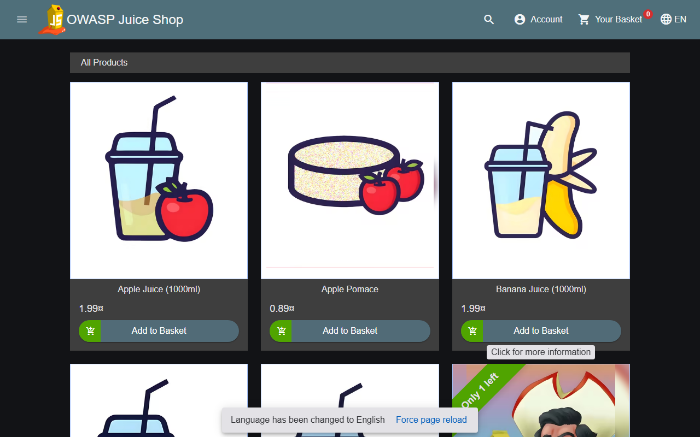

*Figure B1 – Health check: OWASP Juice Shop 20.3.0 served on 127.0.0.1:3000.*

### B.5 Reconnaissance (Nmap)

```powershell
nmap -sT -sV -Pn -p 3000 127.0.0.1 -oN evidence\reconnaissance\EV-001-nmap-local-baseline.txt
```

Expected: `3000/tcp open`, possibly labelled `ppp?`. That label is a fingerprint miss, and the
service is really HTTP.

### B.6 Automated scan (OWASP ZAP)

```powershell
cd "C:\Program Files\ZAP\Zed Attack Proxy"
zap.bat -cmd -quickurl http://127.0.0.1:3000 -quickout "<project>\evidence\automated-scans\EV-002-zap-scan-raw.html" -quickprogress
```

Alternatively, in the GUI use **Automated Scan**, set the URL to `http://127.0.0.1:3000`, then
**Attack**. Treat every alert as a candidate until you verify it manually.

### B.7 Manual verification of each finding

**WA-001 (missing CSP):**

```powershell
curl.exe -s -D - -o NUL http://127.0.0.1:3000/
```

Expected: no `Content-Security-Policy` line.

**WA-002 (CORS wildcard):**

```powershell
curl.exe -s -D - -o NUL -H "Origin: http://evil.example" "http://127.0.0.1:3000/rest/products/search?q=apple"
```

Expected: `Access-Control-Allow-Origin: *`.

**WA-003 (/ftp exposure):** open `http://127.0.0.1:3000/ftp` in the browser, then run:

```powershell
curl.exe -s -o NUL -w "%{http_code}" http://127.0.0.1:3000/ftp/acquisitions.md
```

Expected: a listing of 11 entries, and HTTP 200. Do not open or copy the file contents.

**WA-004 (IDOR), with two new synthetic accounts:**

```powershell
$base = "http://127.0.0.1:3000"; $pw = "Lab-Test-123!"
foreach ($u in "demo.a@lab.test","demo.b@lab.test") {
  Invoke-RestMethod -Method Post "$base/api/Users/" -ContentType "application/json" `
    -Body (@{email=$u;password=$pw;passwordRepeat=$pw} | ConvertTo-Json) | Out-Null }
$A = (Invoke-RestMethod -Method Post "$base/rest/user/login" -ContentType "application/json" -Body (@{email="demo.a@lab.test";password=$pw} | ConvertTo-Json)).authentication
$B = (Invoke-RestMethod -Method Post "$base/rest/user/login" -ContentType "application/json" -Body (@{email="demo.b@lab.test";password=$pw} | ConvertTo-Json)).authentication
curl.exe -s -o NUL -w "No token: %{http_code}`n" "$base/rest/basket/$($A.bid)"       # expect 401
Invoke-RestMethod "$base/rest/basket/$($A.bid)" -Headers @{Authorization="Bearer $($B.token)"} | ConvertTo-Json -Depth 4   # A's basket returned
```

Basket and user ids differ on every fresh container. Always read them from the login response.
Never print or save the tokens.

### B.8 Remediation and retest (WA-001)

Run from `evidence\05-remediation-retest\`:

```powershell
docker run --name csp-proxy -d -p 127.0.0.1:8080:80 `
  -v "${PWD}/csp-proxy.conf:/etc/nginx/conf.d/default.conf:ro" nginx:1.27-alpine
curl.exe -s -D - -o NUL http://127.0.0.1:3000/ | Select-String "Content-Security-Policy"   # nothing
curl.exe -s -D - -o NUL http://127.0.0.1:8080/ | Select-String "Content-Security-Policy"   # present
```

### B.9 Evidence capture and sanitization

- Save each command and its output to a text file named after the finding, for example
  `evidence/manual-tests/WA-00x-*.txt`.
- Redact tokens before saving, for example `<B's JWT, redacted>`.
- Run the team's secret check before submission (Appendix D):

```powershell
py source\custom-script\evidence_toolkit.py evidence-index --dir evidence --check-secrets
```

If `py` is not found, use
`& "$env:LOCALAPPDATA\Programs\Python\Python314\python.exe"` instead.

### B.10 Reset, stop, and cleanup

```powershell
docker restart juice-shop                      # fast reset (Juice Shop resets its data on restart)
docker stop csp-proxy; docker rm csp-proxy     # remove the remediation proxy
docker stop juice-shop; docker rm juice-shop   # remove the target
# docker rmi bkimminich/juice-shop             # optional: remove the image
```

Never use broad commands such as `docker system prune -a`. They would affect unrelated Docker
resources.

### B.11 Troubleshooting

| Problem | Solution |
|---|---|
| Nmap shows `ppp?` | Fingerprint miss. The raw response in the output is HTTP 200 from Juice Shop. |
| `py`/`python` not recognized | Use the full path `%LOCALAPPDATA%\Programs\Python\Python314\python.exe`. |
| ZAP will not start | Install a Java 17 runtime (Temurin). |
| ZAP misses SPA routes | Juice Shop is an Angular SPA. Use the AJAX spider and manual testing. |
| Proxy on :8080 returns 502 | Check that `juice-shop` is running. On Linux add `--add-host=host.docker.internal:host-gateway`. |
| "Email must be unique" on registration | Use new emails or `docker restart juice-shop`. |
| Secret check flags `WA-004-idor-basket.txt` | False positive: the token there is the redacted placeholder `Bearer <B's JWT>`. |

---

## Appendix C: Commands, environment, and authorization

### C.1 Environment inventory (recorded 2026-10-28)

| Component | Version/details |
|---|---|
| Operating system | Windows 11 Pro 10.0.26300.9711 |
| Docker Engine / Compose | 29.9.1 (build dfc520d) / v5.6.0 |
| Target | OWASP Juice Shop 20.3.0, `bkimminich/juice-shop`, digest `sha256:42843723a7bf4246aa5d63c324978b17ef296ac78434aeddd34c427bfb5853f4` |
| Remediation proxy | `nginx:1.27-alpine` (reports `nginx/1.27.5`) |
| Browser | Google Chrome 156.0.8078.48 |
| Nmap | 7.993 (Npcap 1.90) |
| OWASP ZAP | 2.17.0 (Temurin 17 JRE) |
| Python | 3.14.0 |
| Git | 2.52.0.windows.1 |
| Network mode | Loopback only, `127.0.0.1:3000` (target) and `127.0.0.1:8080` (proxy) |

### C.2 Team authorization statement

> The team authorizes testing only against the locally controlled OWASP Juice Shop instance and
> the isolated lab network created for this project. Testing is non-destructive, uses synthetic
> accounts and data, and will stop if activity could affect systems outside the lab.

Approved by Najeeb Abdi (202307172), Mohanad Elhabash (202314448), Moaaz Mohamed (202207862),
and Ahmed Hari (202203669) on 2026-10-28. The testing period was 28 October to 10 November 2026.

### C.3 Commands used, and why each is safe

| Purpose | Command | Why it is safe |
|---|---|---|
| Start target | `docker run --name juice-shop -d -p 127.0.0.1:3000:3000 bkimminich/juice-shop` | Loopback binding; training app |
| Health check | `curl.exe -I http://127.0.0.1:3000` | Single read-only request |
| Isolation check | `docker port juice-shop` | Read-only |
| Recon | `nmap -sT -sV -Pn -p 3000 127.0.0.1` | One port on loopback; no sweep |
| Automated scan | `zap -cmd -quickurl http://127.0.0.1:3000 -quickout …` | Target fixed to loopback |
| WA-001 | `curl.exe -s -D - -o NUL http://127.0.0.1:3000/` | Read-only header request |
| WA-002 | `curl.exe … -H "Origin: http://evil.example" …/rest/products/search?q=apple` | Fake origin header only; no external host contacted |
| WA-003 | `curl.exe -s -I http://127.0.0.1:3000/ftp/acquisitions.md` | HEAD request; contents never stored |
| WA-004 | `POST /api/Users/`, `POST /rest/user/login`, `GET /rest/basket/:id` | Synthetic accounts; read-only on another basket |
| Fix | `docker run --name csp-proxy … nginx:1.27-alpine` | Loopback; app unmodified; removable |
| Cleanup | `docker stop/rm juice-shop csp-proxy` | Named containers only |

### C.4 Selected outputs

The full, unaltered outputs are in the evidence files listed in Appendix E. Key lines:

```text
docker port juice-shop            -> 3000/tcp -> 127.0.0.1:3000
curl http://192.168.199.1:3000    -> HTTP code: 000 (connection failed)
nmap                              -> 3000/tcp open  ppp?   (HTTP 200 from Juice Shop)
ZAP summary                       -> High 0, Medium 2, Low 0, Informational 3
WA-001 (:3000)                    -> no Content-Security-Policy header
WA-002                            -> Access-Control-Allow-Origin: *  (Origin: http://evil.example)
WA-003                            -> /ftp listing, 11 entries; acquisitions.md HTTP 200
WA-004                            -> B's token + /rest/basket/6 -> HTTP 200, "UserId":25
WA-001 retest (:8080)             -> Content-Security-Policy: default-src 'self'; … ; Server: nginx/1.27.5
```

---

## Appendix D: Source code and attribution

### D.1 Team-written code

| File | Purpose | Author |
|---|---|---|
| `source/custom-script/evidence_toolkit.py` | ZAP-JSON triage (`scan-summary`) and evidence indexing with a secret check (`evidence-index`). Standard library only, read-only, no network access. | Team (AI-assisted, see D.4) |
| `evidence/05-remediation-retest/csp-proxy.conf` | nginx configuration that injects the CSP header (WA-001 fix) | Team (AI-assisted, see D.4) |
| `source/report-figures/capture.js` | Produces the report figures: live screenshots of the loopback lab, a capture of the saved ZAP report, terminal-style panels rendered from the unaltered evidence text files, and the architecture diagram | Team (AI-assisted, see D.4) |

**Validation.** On 2026-10-30, `evidence-index --check-secrets` ran on the real `evidence/`
folder. It indexed 17 files and flagged one: `WA-004-idor-basket.txt`. That flag is a false
positive, because the token in that file is a redacted placeholder. `scan-summary` was
validated on the clearly labelled synthetic sample `samples/zap-sample.json`. The real ZAP
report was exported as HTML, which `scan-summary` does not read.

### D.2 `evidence_toolkit.py` (full source)

```python
#!/usr/bin/env python3
"""Evidence toolkit for the CMPS 380 web-application assessment project.

A small, dependency-free helper (Python standard library only) with two jobs:

  scan-summary   Normalize an OWASP ZAP JSON report into a de-duplicated,
                 risk-sorted summary (console table + optional CSV). Helps the
                 team triage raw scanner alerts into candidate findings, and
                 see at a glance how many instances each alert has. Optionally
                 lists Nikto findings alongside for comparison.

  evidence-index Build an index of the files under evidence/ by parsing the
                 project's WA-### / EV-### naming convention, flag files that do
                 not match it, and (optionally) scan text evidence for leftover
                 secrets so they can be sanitized before submission.

Safety: the tool is read-only against its inputs. It never deletes or modifies
evidence; it only reads files and, when asked, writes a summary/index file to a
path you specify. It makes no network connections.
"""

from __future__ import annotations

import argparse
import csv
import json
import re
import sys
from datetime import datetime, timezone
from pathlib import Path

# ZAP encodes risk as a numeric code; map it to a readable label and a sort key.
RISK_LABELS = {"0": "Informational", "1": "Low", "2": "Medium", "3": "High"}
CONFIDENCE_LABELS = {
    "0": "False Positive",
    "1": "Low",
    "2": "Medium",
    "3": "High",
    "4": "Confirmed",
}

# Filenames should start with a finding id (WA-001) or evidence id (EV-001).
ID_PATTERN = re.compile(r"^(?P<id>(?:WA|EV)-\d{3,})\b[-_]?(?P<rest>.*)$", re.IGNORECASE)

# Conservative patterns for things that must be redacted from evidence. These
# only flag candidates for human review; they are not a guarantee of safety.
SECRET_PATTERNS = {
    "authorization-header": re.compile(r"authorization\s*:\s*\S+", re.IGNORECASE),
    "bearer-token": re.compile(r"bearer\s+[A-Za-z0-9._\-]+", re.IGNORECASE),
    "set-cookie": re.compile(r"set-cookie\s*:", re.IGNORECASE),
    "password-field": re.compile(r"password\s*[=:]\s*\S+", re.IGNORECASE),
    "jwt-like": re.compile(r"eyJ[A-Za-z0-9_\-]+\.[A-Za-z0-9_\-]+\.[A-Za-z0-9_\-]+"),
}

TEXT_EXTENSIONS = {".txt", ".log", ".md", ".csv", ".json", ".html", ".htm", ".xml"}


def _now() -> str:
    return datetime.now(timezone.utc).astimezone().strftime("%Y-%m-%d %H:%M:%S %z")


# --------------------------------------------------------------------------- #
# scan-summary
# --------------------------------------------------------------------------- #
def load_zap_alerts(zap_path: Path) -> list[dict]:
    """Return a normalized list of alert rows from a ZAP JSON report."""
    try:
        data = json.loads(zap_path.read_text(encoding="utf-8"))
    except FileNotFoundError:
        sys.exit(f"error: ZAP report not found: {zap_path}")
    except json.JSONDecodeError as exc:
        sys.exit(f"error: {zap_path} is not valid JSON ({exc})")

    rows: list[dict] = []
    for site in data.get("site", []):
        site_name = site.get("@name", "")
        for alert in site.get("alerts", []):
            riskcode = str(alert.get("riskcode", "0"))
            instances = alert.get("instances", []) or []
            # ZAP provides a "count" field; fall back to the instance list.
            try:
                count = int(alert.get("count", len(instances)))
            except (TypeError, ValueError):
                count = len(instances)
            example_uri = instances[0].get("uri", "") if instances else ""
            rows.append(
                {
                    "risk": RISK_LABELS.get(riskcode, riskcode),
                    "risk_sort": int(riskcode) if riskcode.isdigit() else -1,
                    "alert": alert.get("alert") or alert.get("name", ""),
                    "pluginid": alert.get("pluginid", ""),
                    "cweid": alert.get("cweid", ""),
                    "confidence": CONFIDENCE_LABELS.get(
                        str(alert.get("confidence", "")), alert.get("confidence", "")
                    ),
                    "instances": count,
                    "site": site_name,
                    "example_uri": example_uri,
                }
            )
    # Highest risk first, then most instances.
    rows.sort(key=lambda r: (r["risk_sort"], r["instances"]), reverse=True)
    return rows


def load_nikto_findings(nikto_path: Path) -> list[str]:
    """Return Nikto '+' finding lines from a plain-text Nikto report."""
    try:
        text = nikto_path.read_text(encoding="utf-8", errors="replace")
    except FileNotFoundError:
        sys.exit(f"error: Nikto report not found: {nikto_path}")
    return [line.strip() for line in text.splitlines() if line.strip().startswith("+")]


def print_markdown_table(rows: list[dict]) -> None:
    headers = ["Risk", "Alert", "Instances", "Confidence", "Plugin", "CWE", "Example URI"]
    print("| " + " | ".join(headers) + " |")
    print("|" + "|".join(["---"] * len(headers)) + "|")
    for r in rows:
        print(
            f"| {r['risk']} | {r['alert']} | {r['instances']} | {r['confidence']} "
            f"| {r['pluginid']} | {r['cweid']} | {r['example_uri']} |"
        )


def cmd_scan_summary(args: argparse.Namespace) -> int:
    rows = load_zap_alerts(Path(args.zap))

    counts: dict[str, int] = {}
    for r in rows:
        counts[r["risk"]] = counts.get(r["risk"], 0) + 1

    print(f"# ZAP scan summary  (generated {_now()})")
    print(f"Source report: {args.zap}")
    print(f"Distinct alerts: {len(rows)}")
    order = ["High", "Medium", "Low", "Informational"]
    print("By risk: " + ", ".join(f"{k}={counts.get(k, 0)}" for k in order))
    print()
    print_markdown_table(rows)

    if args.nikto:
        nikto = load_nikto_findings(Path(args.nikto))
        print(f"\n## Nikto findings ({len(nikto)}) — review for overlap with the above")
        for line in nikto:
            print(f"- {line}")

    if args.csv:
        out = Path(args.out) if args.out else Path(args.zap).with_suffix(".summary.csv")
        with out.open("w", newline="", encoding="utf-8") as fh:
            writer = csv.DictWriter(
                fh,
                fieldnames=[
                    "risk", "alert", "instances", "confidence",
                    "pluginid", "cweid", "site", "example_uri",
                ],
            )
            writer.writeheader()
            for r in rows:
                writer.writerow({k: r[k] for k in writer.fieldnames})
        print(f"\nCSV written: {out}")

    # A nudge, not a verdict: scanner alerts are hypotheses until verified.
    print("\nReminder: each alert is a candidate finding, not a confirmed "
          "vulnerability. Manually verify before reporting it.")
    return 0


# --------------------------------------------------------------------------- #
# evidence-index
# --------------------------------------------------------------------------- #
def scan_secrets(path: Path) -> list[str]:
    """Return names of secret patterns found in a text file (read-only)."""
    try:
        text = path.read_text(encoding="utf-8", errors="replace")
    except OSError:
        return []
    hits = []
    for name, pattern in SECRET_PATTERNS.items():
        if pattern.search(text):
            hits.append(name)
    return hits


def cmd_evidence_index(args: argparse.Namespace) -> int:
    root = Path(args.dir)
    if not root.is_dir():
        sys.exit(f"error: evidence directory not found: {root}")

    rows: list[dict] = []
    for path in sorted(root.rglob("*")):
        if not path.is_file():
            continue
        match = ID_PATTERN.match(path.name)
        row = {
            "id": match.group("id").upper() if match else "",
            "filename": path.name,
            "path": str(path.relative_to(root.parent)),
            "category": path.parent.name,
            "size_bytes": path.stat().st_size,
            "matches_convention": "Y" if match else "N",
            "possible_secrets": "",
        }
        if args.check_secrets and path.suffix.lower() in TEXT_EXTENSIONS:
            hits = scan_secrets(path)
            if hits:
                row["possible_secrets"] = ";".join(hits)
        rows.append(row)

    print(f"# Evidence index  (generated {_now()})")
    print(f"Scanned: {root}  —  {len(rows)} file(s)")
    nonconforming = [r for r in rows if r["matches_convention"] == "N"]
    flagged = [r for r in rows if r["possible_secrets"]]
    print(f"Not matching WA-/EV- naming: {len(nonconforming)}")
    if args.check_secrets:
        print(f"Files with possible unsanitized secrets: {len(flagged)}")
    print()

    headers = ["ID", "Filename", "Category", "Bytes", "Convention", "Possible secrets"]
    print("| " + " | ".join(headers) + " |")
    print("|" + "|".join(["---"] * len(headers)) + "|")
    for r in rows:
        print(
            f"| {r['id']} | {r['filename']} | {r['category']} | {r['size_bytes']} "
            f"| {r['matches_convention']} | {r['possible_secrets']} |"
        )

    if flagged:
        print("\n## Review before submission — possible unsanitized secrets")
        for r in flagged:
            print(f"- {r['path']}: {r['possible_secrets']}")

    if args.csv:
        out = Path(args.out) if args.out else root / "evidence-index.csv"
        with out.open("w", newline="", encoding="utf-8") as fh:
            writer = csv.DictWriter(
                fh,
                fieldnames=[
                    "id", "filename", "path", "category",
                    "size_bytes", "matches_convention", "possible_secrets",
                ],
            )
            writer.writeheader()
            writer.writerows(rows)
        print(f"\nCSV written: {out}")
    return 0


# --------------------------------------------------------------------------- #
# CLI
# --------------------------------------------------------------------------- #
def build_parser() -> argparse.ArgumentParser:
    parser = argparse.ArgumentParser(
        description="Evidence toolkit: summarize ZAP scans and index evidence.",
    )
    sub = parser.add_subparsers(dest="command", required=True)

    p_scan = sub.add_parser("scan-summary", help="normalize a ZAP JSON report")
    p_scan.add_argument("--zap", required=True, help="path to a ZAP JSON report")
    p_scan.add_argument("--nikto", help="optional path to a Nikto text report")
    p_scan.add_argument("--csv", action="store_true", help="also write a CSV summary")
    p_scan.add_argument("--out", help="CSV output path (default: next to the report)")
    p_scan.set_defaults(func=cmd_scan_summary)

    p_idx = sub.add_parser("evidence-index", help="index files under evidence/")
    p_idx.add_argument("--dir", default="evidence", help="evidence directory (default: evidence)")
    p_idx.add_argument("--check-secrets", action="store_true",
                       help="scan text evidence for leftover secrets")
    p_idx.add_argument("--csv", action="store_true", help="also write evidence-index.csv")
    p_idx.add_argument("--out", help="CSV output path (default: <dir>/evidence-index.csv)")
    p_idx.set_defaults(func=cmd_evidence_index)

    return parser


def main(argv: list[str] | None = None) -> int:
    args = build_parser().parse_args(argv)
    return args.func(args)


if __name__ == "__main__":
    raise SystemExit(main())
```

(The usage-example block of the module docstring is omitted here. It is in the source file.)

### D.3 `csp-proxy.conf` (WA-001 remediation)

```nginx
server {
    listen 80;
    server_name localhost;

    # Restrictive CSP. 'unsafe-inline' for styles is a documented concession to Juice
    # Shop's Angular front end; a greenfield app would use nonces/hashes instead.
    add_header Content-Security-Policy "default-src 'self'; script-src 'self'; style-src 'self' 'unsafe-inline'; img-src 'self' data:; frame-ancestors 'self'; object-src 'none'" always;

    location / {
        # Docker Desktop (Windows/Mac): host.docker.internal -> the host machine.
        proxy_pass http://host.docker.internal:3000;
        proxy_set_header Host              $host;
        proxy_set_header X-Real-IP         $remote_addr;
        proxy_set_header X-Forwarded-For   $proxy_add_x_forwarded_for;
        proxy_set_header X-Forwarded-Proto $scheme;

        # WebSocket support (Juice Shop uses socket.io)
        proxy_http_version 1.1;
        proxy_set_header Upgrade    $http_upgrade;
        proxy_set_header Connection "upgrade";
    }
}
```

### D.4 Third-party software and attribution

| Software / material | Use | License / owner |
|---|---|---|
| OWASP Juice Shop 20.3.0 | Assessment target (unmodified) | MIT, Bjoern Kimminich & OWASP Juice Shop contributors |
| nginx 1.27 (official Docker image) | Remediation reverse proxy | BSD-2-Clause, F5/nginx |
| Nmap 7.993 / Npcap 1.90 | Reconnaissance | Nmap Public Source License, Nmap Software LLC |
| OWASP ZAP 2.17.0 | Automated scanning | Apache 2.0, ZAP project |
| Playwright 1.56.1 (Node.js) | Headless browser used to capture report figures | Apache 2.0, Microsoft |
| Docker Desktop | Container runtime | Docker Inc. |

**AI-tool acknowledgment.** An AI assistant (Claude) helped the team to:
- scaffold and draft the project documentation;
- write the evidence toolkit, the nginx configuration, and the figure-capture script;
- draft parts of this report.

All scans, request/response captures, and findings were produced in the team's own isolated
lab, and every result was checked against the raw evidence files. The figures in this report
are either live screenshots of the lab, or renderings of the unaltered evidence text. **[TEAM]**
Confirm that this statement accurately describes how you used AI before submission.

---

## Appendix E: Screenshots, logs, and evidence index

### E.1 Evidence index

| Evidence ID | File | Finding / use case | What it proves | Sanitized |
|---|---|---|---|---|
| ENV-001 | `evidence/environment/baseline-health.txt` | Environment | Container running; image digest; baseline headers | Yes |
| ENV-002 | `evidence/environment/isolation-check.txt` | Environment | Loopback binding; LAN address unreachable | Yes |
| ENV-003 | `evidence/06-screenshots/ENV-003-juice-shop-home.png` | Environment | App healthy on 127.0.0.1:3000 (Figure B1) | Yes (no session) |
| EV-001 | `evidence/reconnaissance/EV-001-nmap-local-baseline.txt` | TC-001 recon | One open port on loopback (Figure 2) | Yes |
| EV-002 | `evidence/automated-scans/EV-002-zap-scan-raw.html`, `zap-console.log`, `evidence/06-screenshots/EV-002-zap-alert-summary.png` | TC-001 / WA-001, WA-002 | ZAP 2.17.0 quick-scan results (Figure 3) | Yes |
| WA-001 | `evidence/manual-tests/WA-001-csp-headers.txt` | WA-001 | CSP header absent (Figure E3) | Yes |
| WA-002 | `evidence/manual-tests/WA-002-cors-headers.txt` | WA-002 | Wildcard CORS for a foreign origin (Figure E4) | Yes |
| WA-003 | `evidence/manual-tests/WA-003-ftp-exposure.txt`, `evidence/06-screenshots/WA-003-ftp-listing.png` | WA-003 | Unauthenticated listing and download (Figure 4) | Yes (contents not stored) |
| WA-004 | `evidence/manual-tests/WA-004-idor-basket.txt` | WA-004 | B's token returns A's basket (Figure 5) | Yes (JWTs redacted) |
| EV-003 | `evidence/05-remediation-retest/WA-001-before.txt/.png`, `WA-001-after.txt/.png`, `retest-record.md` | WA-001 retest | CSP absent on :3000, present on :8080 (Figures 6–7) | Yes |

### E.2 Additional figures

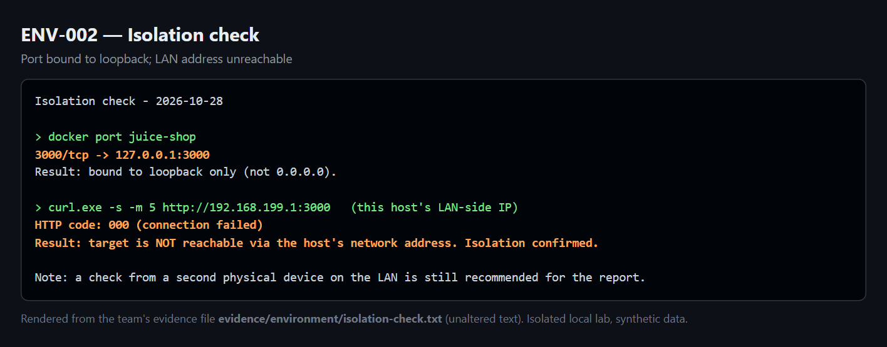

*Figure E2 – Isolation check: the container is bound to loopback, and the host LAN address is
unreachable.*

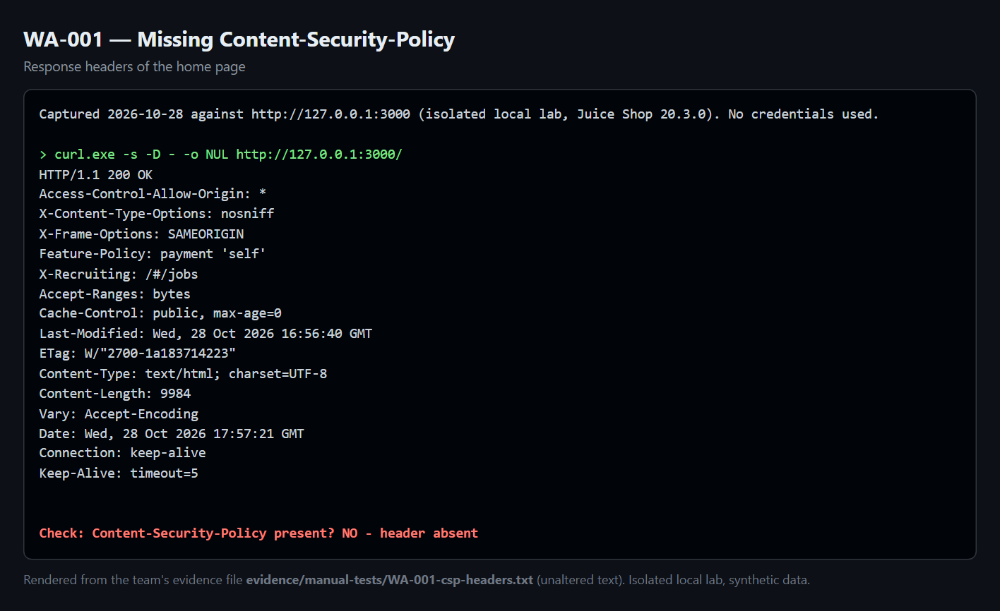

*Figure E3 – WA-001: home-page response headers without Content-Security-Policy.*

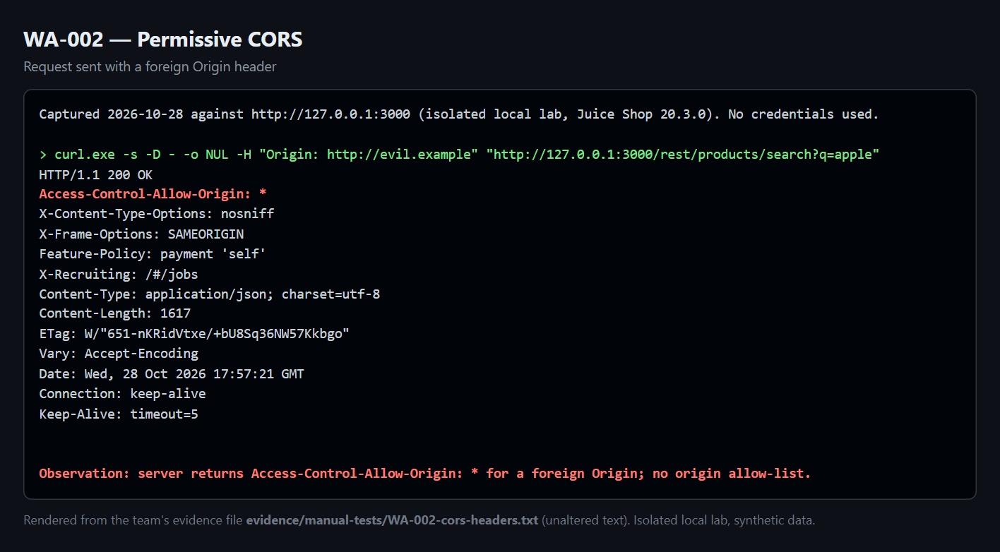

*Figure E4 – WA-002: `Access-Control-Allow-Origin: *` returned to `Origin: http://evil.example`.*

**How the figures were made.** Figures 3, 4, and B1 are live captures:
- Figures 4 and B1 come from the running loopback lab.
- Figure 3 is taken from the saved ZAP report.

Figures 3 and 4 are cropped to the relevant tables and listing. The uncropped captures are
indexed in E.1.

Figures 2, 5, E2, E3, and E4 render the **unaltered** text of the named evidence file as a
terminal-style panel, for readability. In Figure 2, only the long service-fingerprint block is
shortened, and the image marks where. Figures 6 and 7 were captured from the live response
headers on 2026-10-30. Figure 1 is a team-made diagram. All of these were produced with
`source/report-figures/capture.js`, apart from Figures 6 and 7, which come from the retest.

---

## Appendix F: Similarity and attribution log

The team compiled its reading list on 2026-10-28. **[TEAM]** Confirm the access dates when you
re-open each source before submission.

| # | Source | Accessed | What was learned / used | Where cited | Reused code or image? | Rewritten in own words? |
|---|---|---|---|---|---|---|
| 1 | OWASP Top 10:2025 | 2026-10-28 | Category names and numbering (A01, A02) | §2, §7, findings | No | Yes |
| 2 | OWASP Juice Shop project | 2026-10-28 | Target description; deployment command | §2, §4 | No (app run unmodified) | Yes |
| 3 | OWASP WSTG | 2026-10-28 | Test categories and structure of the methodology | §5 | No | Yes |
| 4 | PTES | 2026-10-28 | Phases of the assessment | §5 | No | Yes |
| 5 | OWASP IDOR Prevention Cheat Sheet | 2026-10-28 | IDOR definition; remediation (ownership check) | §7 WA-004 | No | Yes |
| 6 | MDN – Content-Security-Policy | 2026-10-28 | CSP directives used in the fix | §7, §9 | Directive syntax only | Yes |
| 7 | MDN – CORS | 2026-10-28 | Wildcard-origin and credential behaviour | §7 WA-002 | No | Yes |
| 8 | FIRST CVSS v3.1 specification | 2026-10-28 | Base metrics and scoring | §8 | No | Yes |
| 9 | Nmap Reference Guide | 2026-10-28 | Scan flags (`-sT -sV -Pn -p`) | §6, App. B | Command syntax only | Yes |
| 10 | ZAP documentation | 2026-10-28 | Quick-scan command-line options | §6, App. B | Command syntax only | Yes |
| 11 | Docker documentation | 2026-10-28 | Loopback port publishing (`-p 127.0.0.1:…`) | §6, App. B | Command syntax only | Yes |
| — | AI assistant (Claude) | 2026-10-28 to 2026-10-30 | Documentation drafts and the scripts in Appendix D | App. D.4 | Code drafted with AI help, reviewed by the team | Yes; reviewed and edited by the team |

No other group's report or past student work was used. All screenshots and outputs are original
to this team's lab.
